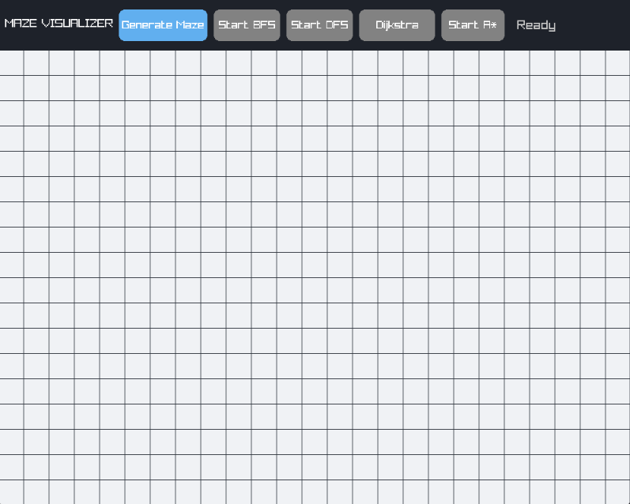
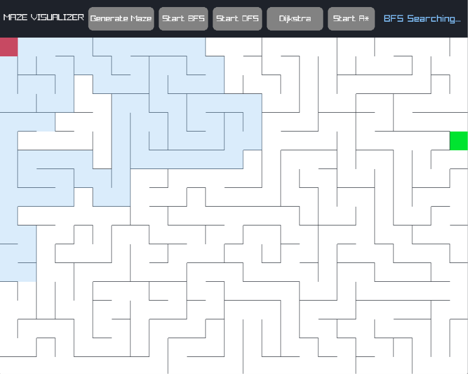
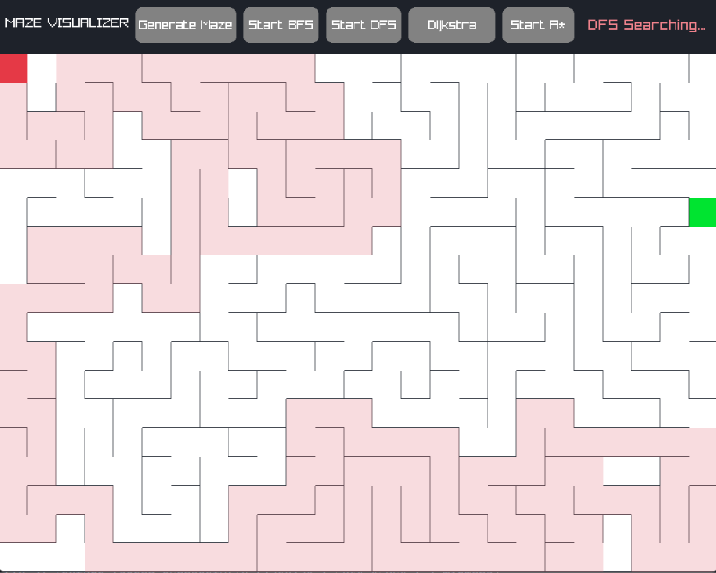
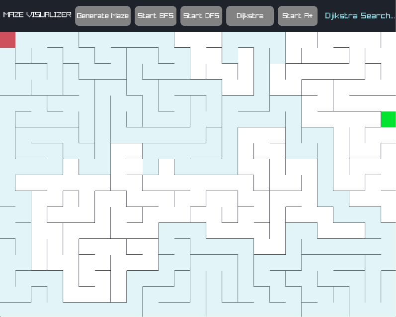
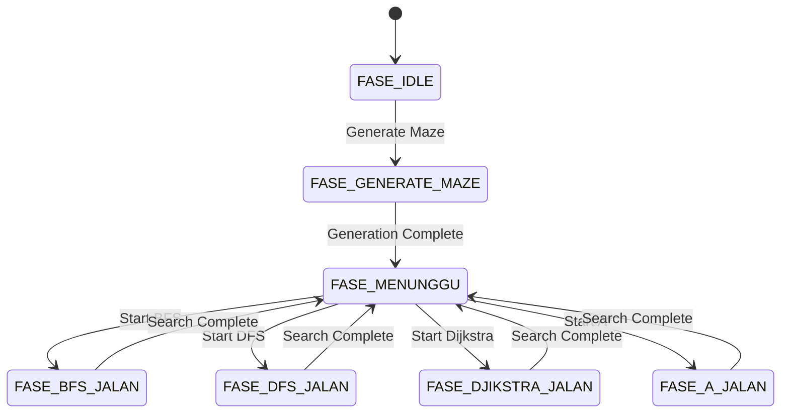

 <div align="center">

# Maze Generator & Pathfinding Visualizer

**Visualizing the logic behind maze generation and pathfinding algorithms.**

A real-time algorithm visualization application built with **C++** and **Raylib**.

<br>



<br>


<br><br>

[Overview](#overview) · [Algorithms](#algorithms) · [Architecture](#architecture) · [Build & Run](#build--run)

</div>

---

## Overview

**Maze Generator & Pathfinding Visualizer** is an interactive application that demonstrates how graph algorithms and fundamental data structures work through real-time visualization.

The application combines two algorithmic processes:

1. **Procedural Maze Generation** — Creates a randomized maze using Depth-First Search (DFS) with stack-based backtracking.
2. **Pathfinding Visualization** — Finds a route between randomly selected start and target positions using BFS, DFS, Dijkstra's Algorithm, or A*.

Each algorithm is processed incrementally across rendering frames, allowing users to observe how nodes are explored and how the final path is reconstructed.

> **Learning Project**
>
> Developed as a hands-on exploration of graph traversal, backtracking, data structures, algorithmic thinking, and real-time rendering using C++ and Raylib.

## Screenshots

<div align="center">

<table>
<tr>
<td width="50%" align="center">

<strong>Application Interface</strong>
<br>
<sub>Main interface and algorithm controls</sub>
</td>
<td width="50%" align="center">

<strong>Maze Generation</strong>
<br>
<sub>Randomized DFS backtracking in action</sub>
</td>
</tr>
<tr>
<td width="50%" align="center">

<strong>Breadth-First Search</strong>
<br>
<sub>Level-by-level exploration</sub>
</td>
<td width="50%" align="center">

<strong>Depth-First Search</strong>
<br>
<sub>Deep-branch exploration and backtracking</sub>
</td>
</tr>
<tr>
<td width="50%" align="center">

<strong>Dijkstra's Algorithm</strong>
<br>
<sub>Priority-based shortest-path exploration</sub>
</td>
<td width="50%" align="center">

<strong>A* Search</strong>
<br>
<sub>Heuristic-guided pathfinding</sub>
</td>
</tr>
</table>

</div>

## Features

- **Procedural Maze Generation** — Generates randomized mazes through iterative DFS backtracking.
- **Four Pathfinding Algorithms** — Compare BFS, DFS, Dijkstra, and A* on the same maze.
- **Step-by-Step Visualization** — Observe node exploration and path reconstruction in real time.
- **Interactive Controls** — Start maze generation and select algorithms through a custom Raylib UI.
- **Finite State Machine** — Controls application flow and prevents algorithm execution during incompatible states.
- **Randomized Endpoints** — Start and target positions are randomized for each new maze.

## Algorithms

### 1. Maze Generation — Randomized DFS

The maze is generated using an iterative Depth-First Search approach with a `std::stack`.

**Process:**

1. Mark the initial cell as visited and push it onto the stack.
2. Find all valid unvisited neighboring cells.
3. Randomly select one neighbor.
4. Remove the wall between the current cell and the selected neighbor.
5. Mark the neighbor as visited and push it onto the stack.
6. Backtrack when no unvisited neighbors remain.

This process creates a *perfect maze*: every cell is reachable, with exactly one path between any two cells.

### 2. Breadth-First Search (BFS)

Uses a `std::queue` to explore neighboring cells level by level.

- Explores nodes in increasing distance from the starting point.
- Stores parent coordinates to reconstruct the final route.
- Guarantees a shortest path in an unweighted graph.

### 3. Depth-First Search (DFS)

Uses a `std::stack` to explore one branch as deeply as possible before backtracking.

- Explores deeper branches before considering alternatives.
- Demonstrates stack-based graph traversal.
- Does not guarantee the shortest path.

### 4. Dijkstra's Algorithm

Uses a `std::priority_queue` to process nodes based on their accumulated movement cost.

- Tracks the lowest known distance to each node.
- Updates parent coordinates when a better route is found.
- Guarantees a shortest path when movement costs are non-negative.

In this implementation, every movement has a cost of 1. Therefore, Dijkstra and BFS produce shortest paths with equivalent optimality guarantees.

### 5. A* Search

Combines the actual movement cost with a heuristic estimate of the remaining distance.

The evaluation function is:

\[
f(n) = g(n) + h(n)
\]

Where:

- \(g(n)\) represents the cost from the starting node.
- \(h(n)\) estimates the remaining distance to the target.
- \(f(n)\) determines the priority of a node.

This implementation uses **Manhattan Distance**:

\[
h(n) = |r_n-r_t| + |c_n-c_t|
\]

Because movement is restricted to four directions with a uniform cost of 1, Manhattan distance is an appropriate heuristic for this grid.

## Algorithm Comparison

| Algorithm | Data Structure | Shortest Path Guarantee |
|:---|:---|:---|
| BFS | `std::queue` | Yes, unweighted graph |
| DFS | `std::stack` | No |
| Dijkstra | `std::priority_queue` | Yes, non-negative weights |
| A* | `std::priority_queue` | Yes, with an admissible heuristic |

**An interesting observation:** Since this maze uses uniform movement costs, BFS and Dijkstra share the same shortest-path guarantee. A* uses additional heuristic information to guide its search toward the target.

## Architecture

### Finite State Machine (FSM)

The application uses a finite state machine to manage its execution flow.

This separates maze generation, pathfinding, and idle states, ensuring that incompatible operations do not run simultaneously.



### Data Structures

The implementation uses several C++ Standard Template Library (STL) containers to manage traversal and path reconstruction.

| Data Structure | Purpose |
|:---|:---|
| `std::stack` | Maze generation and DFS traversal |
| `std::queue` | BFS traversal |
| `std::priority_queue` | Dijkstra and A* node prioritization |
| `std::vector` | Neighbor validation and reconstructed paths |
| 2D Arrays | Grid state, visited cells, distances, and parent tracking |
| `struct GridPos` | Stores row and column coordinates |
| `struct NodePrioritas` | Stores node coordinates and priority cost |

### Visualization Colors

Different colors are used to distinguish the exploration process and reconstructed paths.

| Algorithm | Exploration | Final Path |
|:---|:---|:---|
| BFS | Light Blue | Yellow |
| DFS | Light Red | Purple |
| Dijkstra | Teal | Green |
| A* | Purple | Purple |

Other elements:

- **Start:** Red
- **Target:** Green
- **Walls:** Dark Slate
- **Maze Surface:** White

## Technical Details

| Component | Configuration |
|:---|:---|
| Language | C++ |
| Graphics Library | Raylib |
| Window Resolution | 1000 × 800 |
| Grid Dimensions | 25 Columns × 18 Rows |
| Cell Size | 40 × 40 pixels |
| Header Height | 80 pixels |
| Target Frame Rate | 60 FPS |

The maze generation and pathfinding operations are updated incrementally through the main rendering loop, making their execution visible instead of processing the entire algorithm in a single step.

## Build & Run

### Prerequisites

- C++ compiler (GCC, MinGW, Clang, or MSVC).
- [Raylib 5.0+](https://www.raylib.com/) installed and configured.
- A compatible Windows development environment for the compilation command below.

### Compilation (MinGW / GCC)

Adjust the include and library paths according to your Raylib installation.

```bash
g++ PathfindingVisualizer.cpp -o PathfindingVisualizer.exe -O2 -Wall -I include/ -L lib/ -lraylib -lopengl32 -lgdi32 -lwinmm
```

### Execution

```bash
./PathfindingVisualizer.exe
```

### How to Use

1. Launch the application.
2. Click **Generate Maze** to create a randomized maze.
3. Wait until the generation process is complete.
4. Select one of the available pathfinding algorithms:
   - Start BFS
   - Start DFS
   - Dijkstra
   - Start A*
5. Observe the exploration process and the reconstructed path.
6. Click **Generate Maze** again to create a new environment.

## Project Structure

```text
Maze-Pathfinding-Visualizer/
├── PathfindingVisualizer.cpp
├── README.md
└── assets/
    ├── Home.png
    ├── Build Maze.png
    ├── BFS.png
    ├── DFS.png
    ├── djikstra.png
    └── Astar(1).png
```

## Learning Objectives

This project was developed to explore and practice:

- Graph traversal and search algorithms.
- Stack-based backtracking and procedural generation.
- Shortest-path algorithms and heuristic calculations.
- C++ STL containers and coordinate-based grid management.
- Parent-node tracking and path reconstruction.
- Finite State Machine design.
- Real-time rendering and interactive application logic using Raylib.

## Limitations & Future Improvements

**Current Limitations**

- Core application logic is currently contained in a single source file.
- Grid dimensions and cell size are compile-time constants.
- All movement costs are uniform, so weighted pathfinding scenarios are not yet demonstrated.
- No automated CMake build configuration.

**Roadmap**

- [x] Implement randomized DFS maze generation.
- [x] Implement BFS pathfinding.
- [x] Implement DFS pathfinding.
- [x] Implement Dijkstra's Algorithm.
- [x] Implement A* with Manhattan Distance.
- [ ] Refactor the application into modular components.
- [ ] Introduce weighted terrain for Dijkstra and A*.
- [ ] Add CMake build configuration.
- [ ] Add runtime controls for animation speed and grid dimensions.

## License

This project is licensed under the MIT License. See the [LICENSE](LICENSE) file for details.

---

<div align="center">

**Built with C++ · Raylib · Curiosity**

<sub>Understanding algorithms, one node at a time.</sub>

</div>
