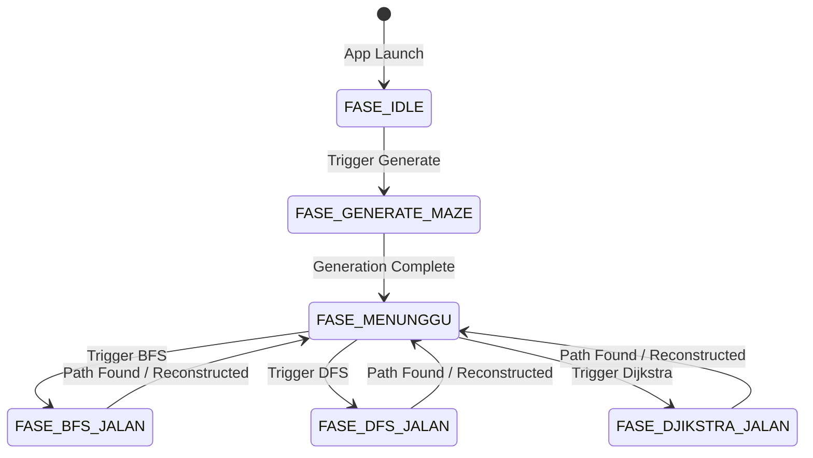

# Maze Generator & Pathfinding Visualizer

An interactive maze generation and pathfinding visualizer built with **C++** and **Raylib**.

This project demonstrates how fundamental algorithms and data structures can be applied to a grid-based environment through real-time visualization. It combines procedural maze generation, graph traversal, backtracking, path reconstruction, and finite state machines into an interactive application.

> **Note:** This project was developed as a hands-on learning endeavor to explore graph algorithms, core C++ data structures, procedural generation, and real-time visualization mechanics.

---

## 📌 Overview

The application consists of two main algorithmic stages:
1. **Maze Generation:** Creates a randomized perfect maze using stack-based Depth-First Search (DFS) backtracking.
2. **Pathfinding:** Searches for a route between the start and target positions using **Breadth-First Search (BFS)**, **Depth-First Search (DFS)**, or **Dijkstra's Algorithm**.

Each algorithm runs incrementally across rendering frames, allowing users to observe the traversal, decision-making processes, and memory state in real-time. A Finite State Machine (FSM) guarantees predictable application flow and prevents logic overlaps.

---

## ✨ Key Features

- **Procedural Maze Generation:** Randomized perfect maze creation using stack-based DFS.
- **Multiple Pathfinding Algorithms:**
  - Breadth-First Search (BFS) for unweighted shortest path.
  - Depth-First Search (DFS) for deep-branch exploration.
  - Dijkstra's Algorithm utilizing a priority queue for cost-based pathfinding.
- **Real-Time Visualization:** Step-by-step rendering of memory traversal and final path reconstruction.
- **Application Architecture:** FSM integration separating UI states from algorithm processing.
- **Custom UI:** Built-in interactive buttons seamlessly integrated with the Raylib rendering context.

---

## ⚙️ Algorithmic Architecture

### Finite State Machine (FSM)
The application utilizes a strict state machine to manage execution flow, ensuring pathfinding cannot trigger while a maze is still generating.



### Core Algorithms

**1. Maze Generation (Randomized DFS)**

* Marks the current cell as visited.
* Finds unvisited neighboring cells.
* Picks a random valid neighbor, removes the wall between them, and pushes the neighbor onto a `std::stack`.
* Backtracks automatically when a dead end is reached until the grid is fully traversed, guaranteeing a perfect maze (no isolated regions, exactly one path between any two points).

**2. Breadth-First Search (BFS)**

* Explores the graph uniformly level by level using a `std::queue`.
* Tracks parent nodes via a 2D array (`AsalUsulBFS`).
* Guarantees the absolute shortest path in an unweighted grid.

**3. Depth-First Search (DFS)**

* Explores branches as deeply as possible before backtracking using a `std::stack`.
* Visualizes path exploration prioritization, though it does not guarantee the shortest path.

**4. Dijkstra's Algorithm**

* Evaluates paths based on movement cost using `std::priority_queue`.
* While identical to BFS in an unweighted grid setup, it serves as the foundational implementation for future weighted terrain generation.

**5. A* (A-Star)

* Combines the actual movement cost g(n) with an estimated remaining cost h(n).
* Uses a std::priority_queue to prioritize nodes with the lowest estimated total cost.
* Calculates the evaluation function using: f(n) = g(n) + h(n)
* Uses Manhattan distance as the heuristic: 
  h(n) = |currentRow - targetRow| + |currentColumn - targetColumn| Because the maze allows movement only in four directions and every movement has a cost of 1, Manhattan distance is an appropriate heuristic for this grid. Stores the lowest known movement cost in CatatanWaktuA and parent coordinates in AsalUsulA. Reconstructs the final path once the target is reached.

---

## 🗄️ Data Structures

Standard C++ Template Library (STL) containers are heavily utilized to manipulate graph data:

| Data Structure | Implementation Usage |
| --- | --- |
| `std::stack` | Maze generation backtracking and DFS traversal. |
| `std::queue` | Level-by-level BFS traversal. |
| `std::priority_queue` | Cost-based node evaluation for Dijkstra's Algorithm. |
| `std::vector` | Temporary neighbor validation lists and path reconstruction storage. |
| `2D Arrays` | Grid state, cellular wall management, and parent-node tracking. |
| `struct GridPos` |	Stores grid coordinates using row and column values.
| `struct NodePrioritas` |	Stores a grid position together with its priority/cost value for priority-queue processing.

---

## 🎨 Visualization Guide

The application maps specific colors to algorithm states for clear visual distinction:

| Element | Visual Output |
| --- | --- |
| **Maze Surface** | Light Gray |
| **Walls** | Dark Slate |
| **Start / Target Node** | Red / Green |
| **BFS** | Light Blue (Exploration) → Yellow (Shortest Path) |
| **DFS** | Light Red (Exploration) → Purple (Discovered Path) |
| **Dijkstra** | Teal (Exploration) → Green (Shortest Path) |
| A*	Purple | (Exploration) → Purple (Final Path)
---

## 🚀 Build and Run Instructions

### Prerequisites

* C++ Compiler (GCC, MinGW, Clang, or MSVC)
* **Raylib 5.0+** installed and configured in your environment.

### Compilation (MinGW/GCC on Windows)

Run the following command in your terminal. *(Adjust library paths `-I` and `-L` according to your Raylib installation directory).*

```bash
g++ main.cpp -o PathfindingVisualizer.exe -O2 -Wall -I include/ -L lib/ -lraylib -lopengl32 -lgdi32 -lwinmm

```

### Execution

```bash
./PathfindingVisualizer.exe

```

### Usage Guide

1. Click **Generate Maze** to build a new randomized perfect maze.
2. Wait for the generation to finish (State: `Waiting`).
3. Click **Start BFS**, **Start DFS**, or **Start Dijkstra** to observe the traversal.
4. Re-click **Generate Maze** to reset the environment.

---

## 📂 Project Structure

```text
Maze-Pathfinding-Visualizer/
├── PathfindingVisualizer.cpp # Core application and algorithm logic
├── README.md                 # Project documentation
├── include/                  # Raylib header files (if local)
├── lib/                      # Raylib static libraries (if local)
└── assets/                   # Documentation assets

```

---

## 🎯 Learning Objectives

This project targets the practical implementation of:

* Memory management using Stack and Queue structures.
* First-principles understanding of graph traversal and backtracking.
* Coordinate mapping inside 1D/2D arrays.
* FSM design patterns for interactive applications.
* Real-time rendering loops using C++ and Raylib.

---

## 🚧 Limitations & Future Improvements

**Current Limitations:**

* Core logic is unified in `PathfindingVisualizer.cpp` for simplicity.
* Grid dimensions and cell size are compile-time constants.
* No automated CMake build configuration.

**Roadmap:**

* [x] Implement Dijkstra's Algorithm.
* [x] Implement A* (A-Star) Algorithm with heuristic calculations.
* [ ] Refactor application into modular classes (e.g., `GridManager`, `Pathfinder`).
* [ ] Add weighted terrains (mud, water) for Dijkstra/A* evaluation.
* [ ] Introduce CMake configuration for cross-platform building.
* [ ] Add runtime UI controls for animation speed and grid dimensions.

---

## 📄 License

This project is an open-source educational endeavor. Feel free to fork, modify, and utilize the code for learning purposes.

```

```
